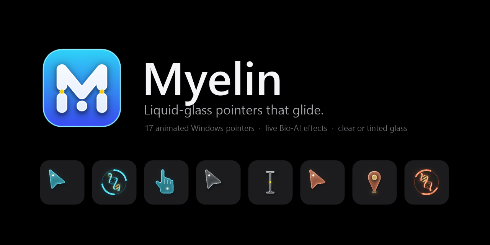
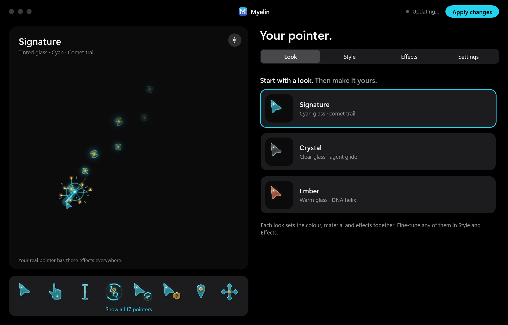
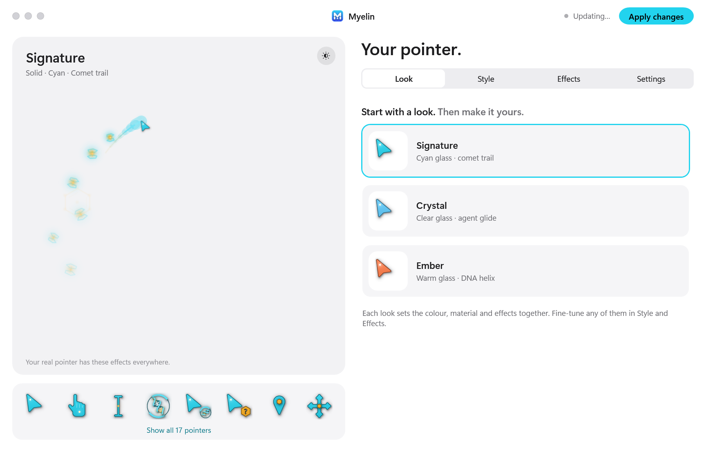
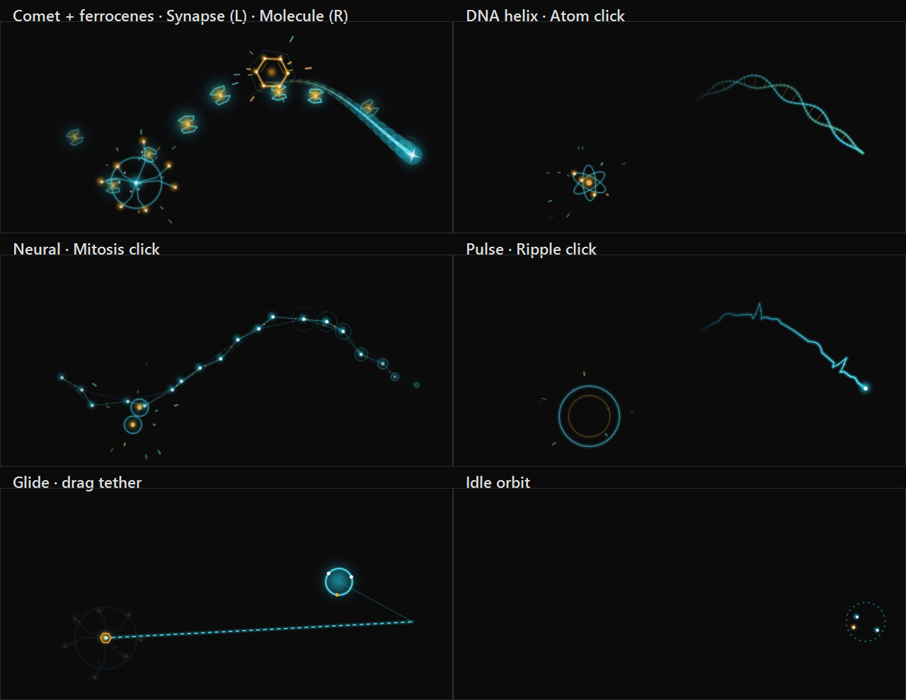
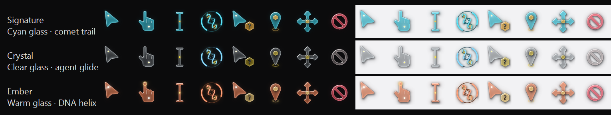
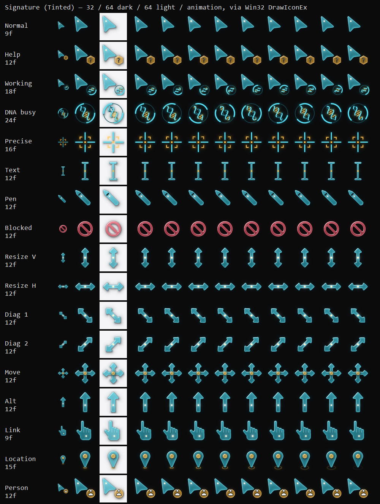
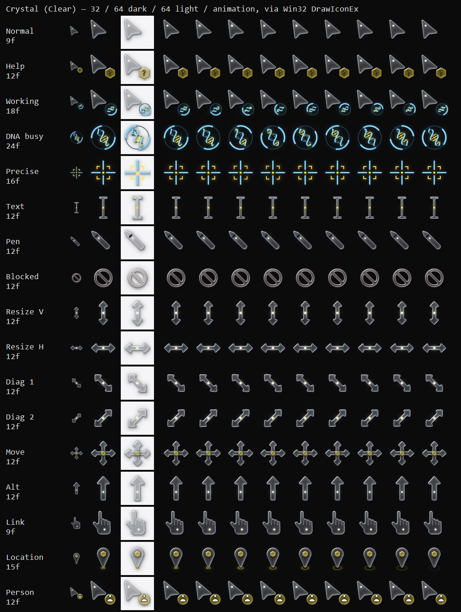

<p align="center">
  
</p>

<h1 align="center">Myelin</h1>

<p align="center">
  <b>Liquid-glass pointers that glide.</b><br/>
  17 animated Windows pointers in clear or tinted glass, with live Bio-AI effects.
</p>

<p align="center">
  
  
  
</p>



## One page, three looks

Myelin opens on a single page: a live stage on the left and your options on the right. Pick one of three premium looks, then make it yours. Every change plays on the stage instantly, and with **Live updates** on, your real Windows pointer follows within a second.

| Look | Glass | Effects |
|---|---|---|
| **Signature** | Tinted cyan | Comet trail shedding ferrocene molecules · Synapse / Molecule clicks |
| **Crystal** | Clear | Agent glide · Ripple / Atom clicks |
| **Ember** | Tinted coral | DNA helix · Mitosis / Atom clicks |

| Dark | Light |
|---|---|
|  |  |

## What's inside

- **Liquid Glass pointers.** All 17 roles Windows uses: translucent glass that thickens toward the rim, a specular highlight on the lit edge, a refraction glow on the far edge, a hairline for light backgrounds, and a soft shadow. They come as Clear or Tinted, in any colour.
- **Bio-AI details.** A DNA-spindle loader whose base pairs bind as it spins, a heartbeat light in the arrow, a benzene nucleus in the location pin, and neural nodes on the resize arrows.
- **Effects everywhere.** They're drawn on a click-through layer above every app:
  - **Trails:** Comet, Glide, DNA helix, Neural, Pulse.
  - **Clicks:** Synapse, Molecule, Atom, Mitosis, Ripple.
  - **Extras:** double-click mitosis, a drag tether and an idle orbit.
- **A Mac-like app.** Traffic-light window controls, absolute black and absolute white themes (or follow Windows), a configurator layout and a tray icon.



<details>
<summary>Every pointer, loaded through the Win32 cursor loader</summary>




</details>

## Install

1. Download `Myelin-vX.Y.Z-win-x64.exe` from **Releases**. It runs without installing .NET. The `-lite` build is smaller but needs the [.NET 10 Desktop Runtime](https://dotnet.microsoft.com/download/dotnet/10.0).
2. Open it, choose a look and press **Use these pointers**.
3. Close the window and Myelin keeps running in the tray. **Restore Windows pointers** puts your exact previous pointers back.

Everything is per-user, so no admin rights are needed. There's no telemetry.

| Shortcut | Action |
|---|---|
| `Ctrl+Alt+M` | Next look |
| `Ctrl+Alt+E` | Effects on / off |

## Command line

```bash
Myelin.exe --apply
```
```bash
Myelin.exe --restore
```
```bash
Myelin.exe --export D:\PointerPacks
```
```bash
Myelin.exe --selftest out
```

- `--apply` installs the saved look without opening the window.
- `--restore` puts back your previous pointers.
- `--export` writes a portable pack with `install.inf`.
- `--selftest` renders the packs, loads every file through Win32 and writes proof images.
- Also available: `--tray`, `--brand <dir>` and `--snap <dir>`.

## Build

```bash
dotnet build src/Myelin -c Release
```
```bash
dotnet publish src/Myelin -c Release -r win-x64 --self-contained true -p:PublishSingleFile=true -p:IncludeNativeLibrariesForSelfExtract=true -o dist
```

Pushing a tag like `v3.0.0` runs `.github/workflows/release.yml`. It builds both executables, runs the self-test and publishes a GitHub Release.

## How it works

- **Rendering.** Each glyph is a vector mask turned into a signed distance field. Liquid Glass shading uses that field's gradient as the surface normal for the specular rim and the refraction. Smooth curves come from morphological rounding on the field. See [RESEARCH.md](RESEARCH.md).
- **File formats.** `.ani` files are RIFF `ACON` with per-frame timing, and `.cur` files hold BMP-32bpp images, matching Windows' own pointers. Windows' ANI loader rejects frames with more than 4 images, so animated pointers ship 32/48/64/128 px.
- **Live updates.** Myelin first renders only the size Windows is using right now (about 0.5 s), then swaps in the full multi-size pack.
- **Effects layer.** A layered, click-through window that only covers the effects' bounding box.

See [CONTRIBUTING.md](CONTRIBUTING.md) for the code map.

## Credits

Designed by **Akash Sk** ([@akashsk.ai](https://www.instagram.com/akashsk.ai/)). Interface reviewed against [Impeccable](https://github.com/pbakaus/impeccable)'s design guidance. Released under the [MIT License](LICENSE).
